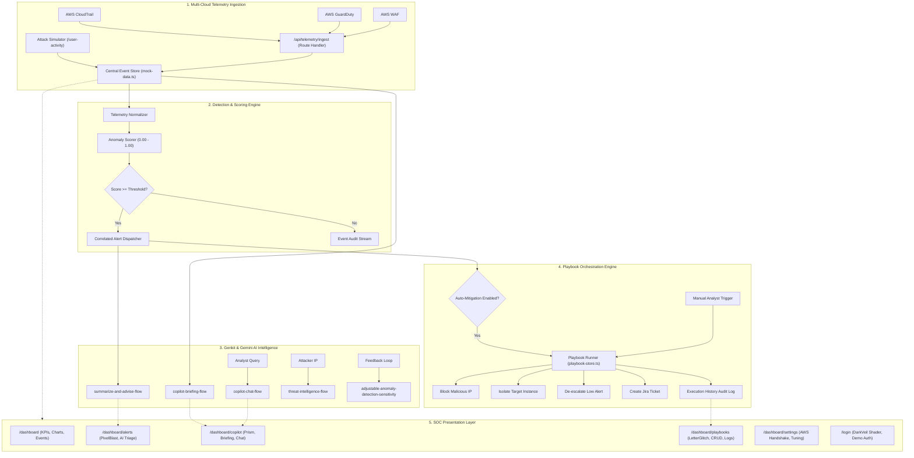

# CloudSentinel: Technical Architecture & System Design Document

## 1. Executive Summary & Objective

**CloudSentinel** is a Next-Generation Cloud Security Operations Center (SOC) platform engineered to solve three critical challenges in modern cloud security:
1. **Telemetry Overload & High-Velocity Attacks**: Cloud environments generate millions of discrete audit logs (AWS CloudTrail, VPC Flow Logs, WAF logs, Kubernetes audit trails), making real-time manual analysis impossible.
2. **Alert Fatigue & Slow Mean Time to Detect (MTTD)**: Traditional rule-based SIEMs trigger excessive false positives. CloudSentinel utilizes continuous anomaly scoring (0.00 to 1.00) and AI-driven contextual evaluation.
3. **Delayed Mean Time to Respond (MTTR)**: Disjointed response workflows leave window of opportunities for attackers. CloudSentinel integrates an automated playbook execution engine that can neutralize threats in real time (e.g. blocking attacking IPs, isolating EC2/Kubernetes instances, and creating incident tickets).

---

## 2. High-Level System Architecture

The following diagram illustrates the end-to-end data pipelines and component interactions across CloudSentinel:



---

## 3. Subsystem Breakdown

### 3.1. Telemetry Ingestion Layer (`/api/telemetry/ingest`)
The ingestion gateway is an asynchronous Next.js Route Handler designed to accept normalized and vendor-specific payloads:
- **AWS CloudTrail Normalization**: Detects IAM events (`CreateUser`, `AttachUserPolicy`), API calls, and error codes (`AccessDenied`, `UnauthorizedOperation`). Maps error states to elevated anomaly scores ($\ge 0.85$).
- **AWS GuardDuty Normalization**: Ingests automated security findings, extracts the remote attacker IP from `networkConnectionAction.remoteIpDetails`, and translates GuardDuty severity scales ($1.0 - 10.0$) to normalized anomaly scores ($0.1 - 1.0$).
- **AWS WAF Normalization**: Detects web layer attacks such as SQL injection (`SQL_INJECTION`), Cross-Site Scripting (`XSS`), or Rate-Limiting ACL actions, mapping terminating block rules to high anomaly ratings ($0.95$).
- **Standardized SOC Event Model**:
  ```typescript
  export type LogEvent = {
    id: string;
    timestamp: string;
    sourceIp: string;
    action: string;
    status: 'Success' | 'Failure';
    anomalyScore: number;
    country: string;
  };
  ```

### 3.2. Anomaly Detection & Adaptive Thresholds
- **Dynamic Thresholding**: The system operates with an analyst-configurable sensitivity threshold $\tau \in [0.1, 1.0]$ (default: $0.85$).
- **Severity Classification**:
  - **High Severity**: $\text{Score} \ge 0.85$ (Critical intrusion attempts, SQL injection, privilege escalation).
  - **Medium Severity**: $0.70 \le \text{Score} < 0.85$ (Repeated authentication failures, suspicious bucket enumerations).
  - **Low Severity**: $\text{Score} < 0.70$ (Benign traffic, regular API read operations).
- **Analyst Feedback Loop**: Through `src/ai/flows/alert-feedback-flow.ts` and `src/app/dashboard/settings/actions.ts`, analyst confirmation or dismissal of alerts dynamically recalculates the detection sensitivity baseline using Gemini AI.

### 3.3. Google Genkit & Gemini AI Intelligence
All AI capabilities are built on Google's enterprise agent framework **Genkit** (`@genkit-ai/googleai`):
1. **Copilot Briefing Flow (`copilot-briefing-flow.ts`)**:
   - Ingests active date-filtered event telemetry, anomaly counts, and top attacker IPs.
   - Prompts Gemini (`gemini-2.5-flash`) to generate structured executive summaries, risk posture evaluation, and tactical containment directives.
   - Built-in deterministic fallback ensures 100% operational uptime during network or quota constraints.
2. **Copilot Chat Flow (`copilot-chat-flow.ts`)**:
   - Interactive conversation flow maintaining SOC analyst context.
   - Analyzes attacking IP reputations, explains technical risks of obscure AWS CloudTrail event names, and provides exact CLI commands for incident response.
3. **Summarize and Advise Flow (`summarize-and-advise-flow.ts`)**:
   - Generates detailed attack timelines, impact assessments, and remediation checklists for individual alerts.
4. **Threat Intelligence Flow (`threat-intelligence-flow.ts`)**:
   - Queries IP threat feeds and risk scores for external IP addresses.

### 3.4. Real-Time Playbook Orchestration Engine (`src/lib/playbook-store.ts`)
CloudSentinel features a client-and-server synchronized SOAR (Security Orchestration, Automation, and Response) engine:
- **Evaluation Loop (`evaluateRealtimePlaybookTriggers`)**:
  - Automatically triggered upon every event ingestion in `mock-data.ts`.
  - If `autoMitigationEnabled` is active, evaluates playbook rules:
    - Rule 1: High severity AND known threat $\rightarrow$ Execute `Block Known Malicious IP`.
    - Rule 2: High anomaly repeated server action $\rightarrow$ Execute `Isolate Suspicious Instance`.
    - Rule 3: Low severity benign event $\rightarrow$ Execute `De-escalate Low-Severity Alerts`.
- **Audit Logging**:
  - Every manual or automated execution writes an `ExecutionLog` entry to disk and browser storage with a persistent trace of the actions taken.
- **Cross-Tab Event Dispatching**:
  - Dispatches `cloudsentinel-playbook-update` and `cloudsentinel-update` CustomEvents so that all open browser sessions reflect real-time mitigation status instantly.

### 3.5. Threat Simulation Lab (`/user-activity`)
To demonstrate and validate the SOC pipeline without waiting for organic cloud breaches, CloudSentinel incorporates a full-fidelity attack simulator:
- **One-Click Attack Vectors**:
  - `AUTH_LOGIN_SQL_INJECTION`: Simulates authentication bypass through SQL injection.
  - `PRIV_ESCALATION`: Simulates unauthorized assumption of AWS IAM administrator roles.
  - `DATA_EXPORT_USER_LIST`: Simulates unauthorized S3 / database bulk exfiltration.
  - `SECURITY_LOG_DISABLED`: Simulates malicious adversaries attempting to stop AWS CloudTrail logging.
  - `FAILED_LOGIN_ATTEMPT`: Simulates credential-stuffing attacks.
- **Automated Background Traffic Generator**: A timer-based synthetic traffic simulator generating mixed benign and malicious events every 3 seconds.

### 3.6. Enterprise Settings & Cloud Integrations (`/dashboard/settings`)
- **AWS Connection Manager**:
  - Multi-region selector (`us-east-1`, `us-west-2`, `eu-west-1`, etc.).
  - Auth mode switcher supporting IAM Role ARNs (with cross-account external IDs) and AWS Access Key IDs.
  - Real-time handshake verification server action (`verifyAwsConnectionAction`) validating credential formats.
  - Webhook URL generator providing ready-to-run cURL snippets for AWS EventBridge and SNS integration.
- **SOAR Automation Controls**: Global toggle allowing SOC administrators to switch between manual analyst approval and fully autonomous real-time mitigation.

---

## 4. Hardware-Accelerated 3D Visual System

To provide an elite, cyber-defense visual identity while maintaining 60 FPS rendering performance, CloudSentinel incorporates specialized WebGL and Three.js ambient components:
1. **DarkVeil (`src/components/DarkVeil.tsx`)**:
   - Built on OGL; renders a raymarched atmospheric veil on the login page with dynamic hue shifting and scanline frequencies.
2. **Prism (`src/components/Prism.tsx`)**:
   - OGL fragment shader component rendering an iridescent refracting prism in the AI Copilot view, symbolizing AI analysis of spectral threat signals.
3. **PixelBlast (`src/components/PixelBlast.tsx`)**:
   - Three.js and Postprocessing shader creating an interactive fluid particle field for the Alerts console.
4. **LetterGlitch (`src/components/LetterGlitch.tsx`)**:
   - High-performance canvas-based matrix glyph generator for the Automated Playbooks console.

---

## 5. End-to-End Incident Lifecycle Walkthrough

```
[Attacker Action]
       │
       ▼
1. Threat Simulation or AWS EventBridge POSTs to `/api/telemetry/ingest`
       │
       ▼
2. Normalizer parses event into `LogEvent` format with calculated Anomaly Score (e.g. 0.94)
       │
       ▼
3. Score exceeds threshold (0.85) ──> An alert is generated and stored
       │
       ├─► 4a. Real-Time Playbook Trigger evaluates:
       │       If Auto-Mitigation is ON:
       │       Dispatches "Block Known Malicious IP" and records in Execution History
       │
       ├─► 4b. AI Copilot Briefing recalculates:
       │       Updates incident counts and highlights attacking IP in the radar
       │
       └─► 4c. SOC Analyst investigates in `/dashboard/alerts`:
               Clicks "AI Analysis" to view Gemini's remediation guidance
               Clicks "Execute Recommended Playbook" for immediate containment
```

---

## 6. Verification, Testing & Build Matrix

| Check | Tool | Status |
|---|---|---|
| **TypeScript Type Safety** | `tsc --noEmit` | **Zero errors (Strict Mode)** |
| **Code Linting** | `next lint` (ESLint 8 + `eslint-config-next@15.3.3`) | **Clean (0 errors, 0 warnings)** |
| **Next.js Production Build** | `next build` (Next.js 15.3.3) | **All 12 routes compiled & optimized** |
| **Client-Side Rendering** | SSR bypass for WebGL canvases | **No hydration mismatches** |
| **Offline AI Resilience** | Fallback intelligence handlers | **Operational with or without API key** |

---

## 7. Conclusion

CloudSentinel bridges the gap between passive log aggregation and autonomous cloud defense. By pairing **real-time SIEM telemetry ingestion** with **Google Gemini's reasoning capabilities** and an **automated SOAR execution engine**, CloudSentinel reduces incident response times from hours to milliseconds.
