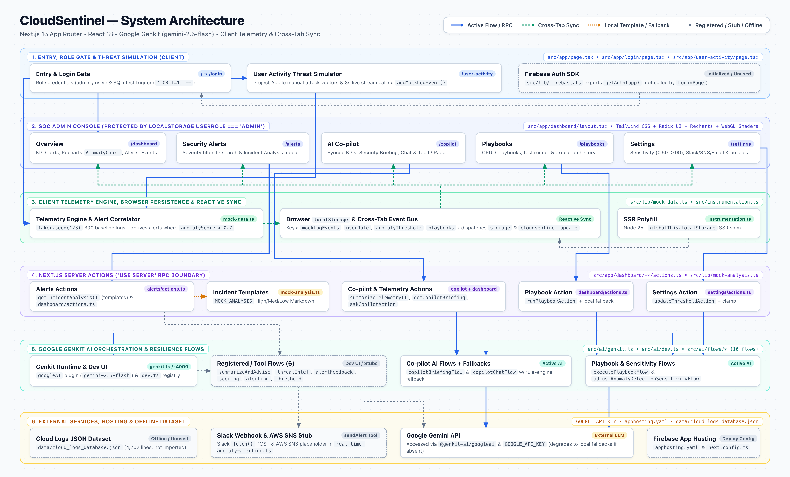

# CloudSentinel: AI-Powered Cloud Threat Detection & Automated SOC Response



## Overview

**CloudSentinel** is an enterprise-grade cloud security intelligence, SIEM anomaly detection, and automated incident response platform. Powered by **Next.js 15 (App Router)**, **TypeScript**, and **Google Genkit with Gemini**, CloudSentinel provides SOC teams with real-time telemetry ingestion, machine-learning-driven anomaly scoring, an interactive AI SOC Copilot, and automated incident mitigation playbooks.

---

## Key Capabilities & Modules

### 1. Unified Security Dashboard (`/dashboard`)
- **Real-Time SOC Metrics**: Instant visibility into Total Events, Anomalies Detected, Alerts Dispatched, and Critical High-Severity Incidents.
- **Anomaly Score Timeline**: Interactive time-series area charts built with Recharts, displaying normalized anomaly score trends with date-range synchronization.
- **Comprehensive Event Telemetry Table**: Real-time log table with country flags, IP geolocation, action tags, status indicators, and anomaly scores.
- **Synchronized Date Range Picker**: Preset intervals (*Today, Yesterday, Last 7 Days, Last 30 Days, Month to Date*) and custom calendar ranges.

### 2. Correlated Security Alerts & AI Incident Analysis (`/dashboard/alerts`)
- **Severity-Based Triage**: Correlated alerts tagged as High, Medium, or Low severity based on dynamic threshold evaluations.
- **One-Click AI Incident Summarization**: Modal powered by Gemini AI that unpacks the attack context, technical impact, affected resources, and specific mitigation steps.
- **Direct Playbook Execution**: Trigger instant mitigation directly from the alert modal (e.g. immediately block the malicious IP or quarantine the target server).
- **PixelBlast Ambient Visuals**: Interactive background shader providing high-tech SOC aesthetics.

### 3. AI SOC Copilot (`/dashboard/copilot`)
- **Live Security Briefing**: Real-time executive security briefing synthesized directly from the active dashboard telemetry and date filters, highlighting critical threats and active attacker IPs.
- **Interactive SOC Chat**: Analyst-in-the-loop chat powered by Google Gemini, capable of investigating incidents, analyzing IP reputation, and suggesting containment playbooks.
- **Suggested Tactical Queries**: Fast one-click queries (*"List high-severity alerts"*, *"Investigate top attacker IP"*, *"Recommend mitigation playbooks"*, *"Explain SQL injection risk"*).
- **Live Suspicious IP Radar**: Real-time radar table tracking repeat attacking IPs, event frequency, and anomaly ratings.
- **Prism WebGL Shader**: Hardware-accelerated ambient visual backdrop.

### 4. Automated Incident Response Playbooks (`/dashboard/playbooks`)
- **Automated Real-Time Mitigation**: When enabled, incoming anomalous events automatically trigger matching containment workflows without manual intervention.
- **Default SOC Playbooks**:
  - `Block Known Malicious IP`: Adds threat actor IP to firewall/WAF blocklists and generates a high-priority incident ticket.
  - `Isolate Suspicious Instance`: Applies quarantine security group and captures EBS snapshots for forensic analysis.
  - `De-escalate Low-Severity Alerts`: Automatically resolves false positives and non-threatening alerts to prevent SOC alert fatigue.
  - `Create Investigation Ticket`: Automatically routes medium-severity incidents to the Tier-1 Analyst queue.
- **Playbook Execution History Log**: Complete audit log recording timestamp, execution mode (*Manual* vs. *Automated (Real-Time)*), playbook ID, trigger events, source IPs, and action results.
- **Custom Playbook Management**: Interactive modals to create custom playbooks, edit triggers/actions, toggle automation, or reset to factory defaults.
- **LetterGlitch Visual Effect**: Matrix-inspired typographic background.

### 5. Multi-Cloud & AWS Ingestion Gateway (`/api/telemetry/ingest`)
- Real-time HTTP POST ingestion endpoint for multi-cloud security telemetry.
- **Native Support for AWS Security Services**:
  - **AWS CloudTrail**: Detects dangerous API calls, authentication anomalies, and IAM privilege escalations.
  - **AWS GuardDuty**: Ingests threat findings, extracts malicious remote IPs, and maps severity levels.
  - **AWS WAF**: Ingests blocked requests, extracts SQL injection signatures, and captures client IP headers.
  - **Generic JSON Telemetry**: Ingests custom SIEM, container, or server logs.
- **Health Check (`GET`)**: Endpoint returns gateway status, active pipelines, and supported sources.

### 6. Interactive Threat Simulation Lab (`/user-activity`)
- **Simulate Real Attack Scenarios**:
  - SQL Injection attempts (`AUTH_LOGIN_SQL_INJECTION`)
  - Privilege Escalation (`PRIV_ESCALATION`)
  - Unauthorized Data Exfiltration (`DATA_EXPORT_USER_LIST`)
  - Security Logging Tampering (`SECURITY_LOG_DISABLED`)
  - Brute Force Login Spikes (`FAILED_LOGIN_ATTEMPT`)
  - Container Deployments (`CONTAINER_DEPLOY`)
- **Custom Event Injection**: Dispatch custom actions with user-defined anomaly scores and threat flags.
- **Automated Background Traffic Generator**: Dispatches synthetic SOC traffic every 3 seconds to test live alerting and automated playbooks.
- **Multi-Tab Reactive State Sync**: Actions dispatched in the simulator instantly update the Dashboard, Alerts, Playbooks, and Copilot across open browser tabs.

### 7. Enterprise Settings & Cloud Integrations (`/dashboard/settings`)
- **Dynamic Sensitivity Adjustment**: Slide to adjust anomaly score thresholds (0.1 to 1.0) with AI feedback optimization.
- **AWS Connection Manager**:
  - Region selection (e.g. `us-east-1`, `us-west-2`, `eu-west-1`).
  - Authentication via IAM Role ARN (Cross-Account) or Access Key / Secret Key.
  - Live Handshake Verification server action testing AWS connectivity.
  - Dynamic Webhook URL generator with copyable cURL sample command.
- **Automated Mitigation Switch**: Global toggle for automated playbook execution.
- **Notification Channels**: Configure routing to Slack, PagerDuty, Webhooks, or Email.

### 8. Cyber Defense Authentication (`/login`)
- Custom **DarkVeil** WebGL shader login background.
- Pre-configured demo credentials for SOC Admin (`admin@cloudsentinel.io`) and SOC Analyst (`user@cloudsentinel.io`).
- Live SQL injection detection sandbox test (`' OR 1=1; --`).

---

## Architecture & Tech Stack

| Layer | Technologies |
|---|---|
| **Frontend Framework** | [Next.js 15](https://nextjs.org/) (App Router, Server Actions, Route Handlers) |
| **Language & Runtime** | [TypeScript 5](https://www.typescriptlang.org/), [Node.js](https://nodejs.org/) |
| **Styling & UI** | [Tailwind CSS](https://tailwindcss.com/), [Radix UI](https://www.radix-ui.com/), [Lucide React](https://lucide.dev/) |
| **AI & LLM Orchestration** | [Google Genkit](https://firebase.google.com/docs/genkit) + [Google Gemini 2.5 Flash](https://ai.google.dev/) |
| **Visual Effects & 3D** | [Three.js](https://threejs.org/), [OGL](https://github.com/oframe/ogl), [Postprocessing](https://github.com/pmndrs/postprocessing) |
| **Charts & Metrics** | [Recharts](https://recharts.org/), [Date-fns](https://date-fns.org/) |
| **State Synchronization** | Browser Storage Events (`CustomEvent`, `localStorage`) for zero-lag multi-tab updates |

---

## Project Structure

```
Cloud-Sentinel/
├── .eslintrc.json                          # ESLint configuration
├── cloudsentinel-architecture.png          # High-resolution architecture diagram
├── components.json                         # Shadcn UI configuration
├── data/
│   └── cloud_logs_database.json            # Pre-seeded cloud audit logs database
├── next.config.ts                          # Next.js configuration
├── package.json                            # Dependencies and scripts
├── postcss.config.mjs                      # PostCSS plugins
├── tailwind.config.ts                      # Tailwind CSS configuration
├── tsconfig.json                           # TypeScript compiler options
├── PROJECT_EXPLANATION.md                  # Comprehensive architectural guide
├── README.md                               # Project documentation
├── public/                                 # Static assets
└── src/
    ├── ai/
    │   ├── dev.ts                          # Genkit developer server runner
    │   ├── genkit.ts                       # Genkit initialization with Google AI plugin
    │   └── flows/
    │       ├── adjustable-anomaly-detection-sensitivity.ts
    │       ├── adjustable-anomaly-threshold.ts
    │       ├── alert-feedback-flow.ts
    │       ├── automated-response-playbook-flow.ts
    │       ├── copilot-briefing-flow.ts
    │       ├── copilot-chat-flow.ts
    │       ├── model-based-anomaly-scoring.ts
    │       ├── real-time-anomaly-alerting.ts
    │       ├── summarize-and-advise-flow.ts
    │       └── threat-intelligence-flow.ts
    ├── app/
    │   ├── globals.css                     # Global design styles and glassmorphism
    │   ├── layout.tsx                      # Root application layout
    │   ├── page.tsx                        # Redirect to dashboard / login
    │   ├── api/
    │   │   └── telemetry/
    │   │       └── ingest/
    │   │           └── route.ts            # AWS & multi-cloud telemetry ingestion API
    │   ├── dashboard/
    │   │   ├── actions.ts                  # Server actions for dashboard
    │   │   ├── layout.tsx                  # Dashboard layout with navigation sidebar
    │   │   ├── page.tsx                    # Main SOC dashboard
    │   │   ├── alerts/
    │   │   │   ├── actions.ts              # Alert triage & incident analysis server actions
    │   │   │   └── page.tsx                # Security alerts console
    │   │   ├── copilot/
    │   │   │   ├── actions.ts              # Copilot chat & briefing server actions
    │   │   │   └── page.tsx                # Interactive AI SOC Copilot
    │   │   ├── playbooks/
    │   │   │   └── page.tsx                # Incident response playbooks & execution log
    │   │   └── settings/
    │   │       ├── actions.ts              # Threshold & AWS verification server actions
    │   │       └── page.tsx                # Settings & cloud integration hub
    │   ├── login/
    │   │   └── page.tsx                    # Authentication page with DarkVeil shader
    │   └── user-activity/
    │       └── page.tsx                    # Attack simulation & traffic generator
    ├── components/
    │   ├── DarkVeil.tsx                    # OGL WebGL shader for login
    │   ├── LetterGlitch.tsx                # Matrix-style canvas animation for Playbooks
    │   ├── PixelBlast.tsx                  # Three.js interactive canvas for Alerts
    │   ├── Prism.tsx                       # OGL prism visual for Copilot
    │   ├── date-range-picker.tsx           # Controlled date range selector with presets
    │   ├── logo.tsx                        # CloudSentinel branding logo
    │   ├── theme-provider.tsx              # NextThemes dark/light theme wrapper
    │   ├── time-ago.tsx                    # Relative time formatter
    │   ├── dashboard/
    │   │   ├── anomaly-chart.tsx           # Anomaly trend area chart
    │   │   ├── events-table.tsx            # Telemetry events data table
    │   │   ├── kpi-cards.tsx               # Top-level metric cards
    │   │   └── recent-alerts.tsx           # Recent critical alerts list
    │   └── ui/                             # Radix UI primitives (button, card, dialog, etc.)
    ├── hooks/
    │   ├── use-mobile.tsx                  # Responsive layout hook
    │   └── use-toast.ts                    # Notification toast hook
    ├── lib/
    │   ├── firebase.ts                     # Firebase client configuration
    │   ├── mock-analysis.ts                # Incident analysis templates & fallback responses
    │   ├── mock-data.ts                    # Telemetry event store & reactive event emitter
    │   ├── playbook-store.ts               # Playbook registry, execution engine & audit history
    │   └── utils.ts                        # Tailwind class utilities (cn)
    └── types/
        ├── index.ts                        # Core data models (LogEvent, Alert)
        └── ogl.d.ts                        # Type definitions for OGL 3D library
```

---

## Telemetry Ingestion API

CloudSentinel exposes a high-throughput endpoint for cloud providers:

### Ingest Endpoint: `POST /api/telemetry/ingest`

#### Example 1: AWS CloudTrail Event
```bash
curl -X POST http://localhost:3000/api/telemetry/ingest \
  -H "Content-Type: application/json" \
  -d '{
    "source": "aws.cloudtrail",
    "detail": {
      "eventName": "AuthorizeSecurityGroupIngress",
      "sourceIPAddress": "198.51.100.24",
      "errorCode": null
    }
  }'
```

#### Example 2: AWS GuardDuty Finding
```bash
curl -X POST http://localhost:3000/api/telemetry/ingest \
  -H "Content-Type: application/json" \
  -d '{
    "source": "aws.guardduty",
    "detail": {
      "type": "UnauthorizedAccess:EC2/SSHBruteForce",
      "severity": 8.0,
      "service": {
        "action": {
          "networkConnectionAction": {
            "remoteIpDetails": { "ipAddressV4": "203.0.113.88" }
          }
        }
      }
    }
  }'
```

#### Example 3: AWS WAF Web ACL Block
```bash
curl -X POST http://localhost:3000/api/telemetry/ingest \
  -H "Content-Type: application/json" \
  -d '{
    "source": "aws.waf",
    "action": "BLOCK",
    "httpRequest": { "clientIp": "198.51.100.99" },
    "terminatingRuleMatchDetails": [{ "conditionType": "SQL_INJECTION" }]
  }'
```

---

## Setup & Running the Application

### 1. Prerequisites
- **Node.js**: v18.0.0 or higher
- **npm**: v9.0.0 or higher

### 2. Installation
```bash
# Clone the repository
git clone https://github.com/puneeth-sarji/Major-project.git
cd Major-project

# Install dependencies
npm install
```

### 3. Environment Configuration
Create a `.env` file in the root directory:
```bash
GOOGLE_API_KEY=your_google_gemini_api_key
```
> **Note**: CloudSentinel includes built-in fallback resilience so all UI and telemetry features remain fully operational even if no API key is provided.

### 4. Running the Development Server
```bash
npm run dev
```
Open [http://localhost:3000](http://localhost:3000) in your browser.

### 5. Verification & Quality Checks
```bash
# Type check TypeScript codebase
npm run typecheck

# Run Next.js ESLint
npm run lint

# Create production build
npm run build

# Start production server
npm start
```

### 6. Genkit AI Developer Console (Optional)
```bash
npm run genkit:dev
```
Accessible at [http://localhost:4000](http://localhost:4000).

---

## License
This project is licensed under the MIT License.
